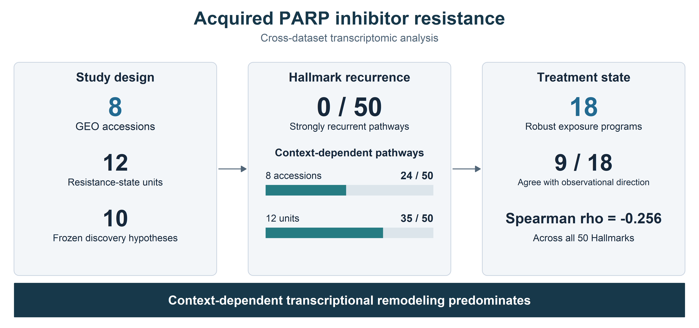

# PARPi resistance transcriptomics
Cross-dataset recurrence of transcriptional programs in acquired PARP-inhibitor resistance. This research repository tests whether discovery-derived Hallmark hypotheses recur across heterogeneous cancer models while separating accession-level evidence, model-level sensitivity and treatment exposure.

**Version 1.0.0 candidate — private, unreleased.** The supported frozen-input synthesis passes 46/46 comparisons. Full raw-to-results reproduction is not established. Public release awaits the author's historical-email privacy decision; see [release audit](RELEASE_AUDIT.md).

## Study design

Eight GEO accessions were analyzed separately using expression-data-appropriate workflows. Ten Hallmark hypotheses were fixed in the discovery dataset before external validation. The primary synthesis uses one conservative vote per accession; a secondary analysis uses 12 model/contrast units. Treatment-state comparisons and the D8 serial-selection trajectory are complementary analyses, not additional independent accession votes.

| ID | GEO accession | System |
|---|---|---|
| D1 | [GSE235980](https://www.ncbi.nlm.nih.gov/geo/query/acc.cgi?acc=GSE235980) | UWB1.289, BRCA1-deficient and restored backgrounds |
| D2 | [GSE117765](https://www.ncbi.nlm.nih.gov/geo/query/acc.cgi?acc=GSE117765) | PEO1 |
| D3 | [GSE153867](https://www.ncbi.nlm.nih.gov/geo/query/acc.cgi?acc=GSE153867) | A2780 |
| D4 | [GSE342642](https://www.ncbi.nlm.nih.gov/geo/query/acc.cgi?acc=GSE342642) | HGSOC PDX; public input identity verified |
| D5 | [GSE202434](https://www.ncbi.nlm.nih.gov/geo/query/acc.cgi?acc=GSE202434) | HCC1806 and PSN1, talazoparib maintenance/withdrawal |
| D6 | [GSE191231](https://www.ncbi.nlm.nih.gov/geo/query/acc.cgi?acc=GSE191231) | Recurrent HGSOC PDX after olaparib selection |
| D7 | [GSE165914](https://www.ncbi.nlm.nih.gov/geo/query/acc.cgi?acc=GSE165914) | MDA-MB-468 and SUM1315 |
| D8 | [GSE163854](https://www.ncbi.nlm.nih.gov/geo/query/acc.cgi?acc=GSE163854) | PH039 PDX, serial niraparib selection |

GSE287274 was excluded because the required sample-level metadata and expression data could not be recovered reproducibly at the time of eligibility assessment.

## Final findings
| Classification | Eight accessions | Twelve model/contrast units |
|---|---:|---:|
| Strong recurrent | 0 | 0 |
| Directional | 4 | 5 |
| Context-dependent | 24 | 35 |
| Dataset/unit-specific | 12 | 5 |
| Inconsistent | 10 | 5 |

The twelve units are not twelve independent studies. Nine of ten frozen discovery hypotheses are context-dependent at accession level. Glycolysis is inconsistent at accession level and context-dependent at model level. These classifications quantify recurrence under the specified rules; they do not rule out shared biological resistance mechanisms.

D7 models agree in direction for 33/50 Hallmarks, with six concordant-significant pathways. D8 has 15 primary significant Hallmarks, 14 robust to sensitivity analysis. Adding D7/D8 changes 18/50 historical classifications.

Treatment-state comparisons are complementary observational analyses, not causal drug-effect estimates. Observational and D5 exposure effects show Spearman rho -0.255702280912365 and directional agreement 24/50. Eighteen D5 exposure programs are robust; nine agree with the observational direction. Supplement S3 applies the documented strict separation hierarchy: Strong convergent/Convergent/D5-specific exposure/Observational-only/Weak/mixed = 0/9/9/2/30.

## Files and reproduction
- [Final Figures 1-5/S1-S4 and captions](figures/publication/FIGURE_LEGENDS.md), [figure source map](figures/publication/FIGURE_SOURCE_MAP.csv), [graphical abstract source](scripts/publication/64_FINAL_graphical_abstract.R).
- [Supplementary tables](supplementary/README.md), including [workbook](supplementary/Supplementary_Tables_S1-S3.xlsx).
- [Supported reproduction instructions](REPRODUCING.md), [software environments](environment/README.md), [status and limitations](REPRODUCTION_STATUS.md).
- [Raw-data acquisition](DATA_ACQUISITION.md), [dataset and contrast manifest](metadata/DATASET_CONTRAST_MANIFEST.csv).
- [Repository map](STRUCTURE.md), [file manifest](RELEASE_MANIFEST.csv), [release checklist](provenance/RELEASE_CHECKLIST.md), [release notes](RELEASE_NOTES_v1.0.0.md).

The isolated runner regenerates final integration from six frozen inputs and compares 46 columns. The archived D4 reconstruction reproduces 14,277 retained genes and six statistics; the historical D1-D6 reconstruction reproduces 50 pathways/49 columns from eleven source tables. These are distinct levels of evidence. Historical numbered scripts may write results or install packages; use the guarded runner rather than executing the entire directory.

## Provenance limitations
Recovered candidate scripts 18 and 45 are not proven executed historical originals. Historical software/database records are incomplete. Only eleven overlapping script-62 fields have frozen historical comparators. Final manuscript PNGs were recovered unchanged from the supplied author-review manuscript; editable final assembly sources were not recovered. The D6 article-accession discrepancy is disclosed in data documentation. Original manuscript text is not distributed. [AI-assisted preparation](AI_ASSISTANCE.md) is disclosed separately.

## Author, license and citation
Vegi Surya Vara Prasad — [ORCID 0009-0000-9344-7810](https://orcid.org/0009-0000-9344-7810). Intended journal: Computational Biology and Chemistry; manuscript in preparation.

Original software: [MIT](LICENSE). Eligible original derived outputs: CC BY 4.0, with [scope](LICENSING.md) and [third-party attribution](THIRD_PARTY_RIGHTS.md). Cite [CITATION.cff](CITATION.cff). No article DOI, archive DOI or release date is invented.
